# Enterprise Firewall Telemetry & Security Operations Center

[](https://vuejs.org/)
[](https://www.typescriptlang.org/)
[](https://tailwindcss.com/)
[](https://nodejs.org/)
[](https://www.postgresql.org/)
[](https://www.influxdata.com/)
[](https://www.docker.com/)
[](https://www.cert-in.org.in/)
[](#licensing-structure)

> **Developed by the Information and Communication Technology Division (ICTD)**  
> **CSIR - Structural Engineering Research Centre (CSIR-SERC)**  
> *Council of Scientific and Industrial Research, Ministry of Science & Technology, Government of India*

---

## Executive Summary

The **Enterprise Firewall Telemetry & Security Operations Center** is an on-premises, single-host security observability, flow analysis, and policy audit platform designed for mission-critical enterprise and government networks. 

Engineered from the ground up for high-throughput perimeter firewalls (specifically **Fortinet FortiGate** along with support for **Check Point**, **Palo Alto Networks**, and **pfSense**), the system aggregates hardware telemetry, sub-second interface metrics, binary NetFlow/IPFIX records, high-velocity syslogs, and canonical security policies into a unified, responsive operations center conforming to **UX4G** design standards.

The application is architected as an **all-in-one Virtual Appliance (VM)** featuring a guided first-time setup wizard, customizable organization branding and logos, role-based access control with superadmin safeguards, high-velocity **InfluxDB 2.7 Time-Series** log ingestion, automated **PostgreSQL 18** telemetry persistence, and over-the-air (OTA) update readiness.

---

## Visual Tour & Core Capabilities

### 1. Split-Screen Glassmorphic Operator Sign In
A cybersecurity-themed sign-in portal featuring a live telemetry sidebar with WAN bandwidth gauges, CPU and memory gauges, sensor readings, and an isometric command background. No hardcoded or auto-filled passwords—operators enter their own passkeys set during initial deployment.

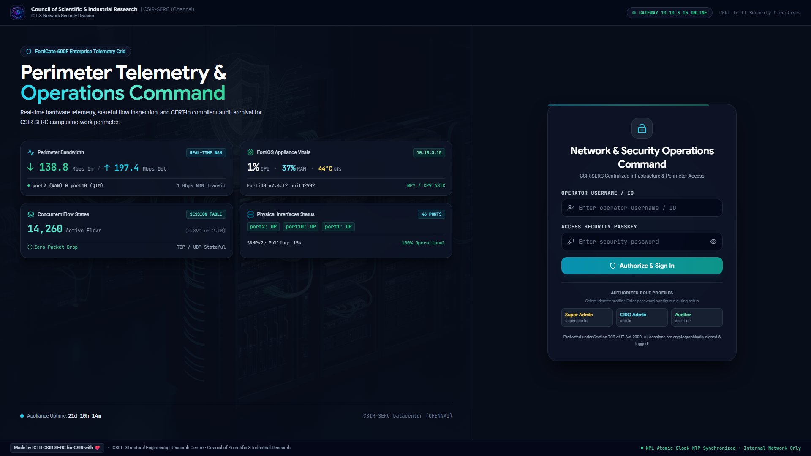

---

### 2. First-Time Setup Wizard (Virtual Appliance & Raw Linux Ready)
Upon booting the appliance or raw Linux server and opening its IP in a browser, operators can configure organization branding, custom logo, SNMP polling targets, core switch monitoring, and administrative passkeys.

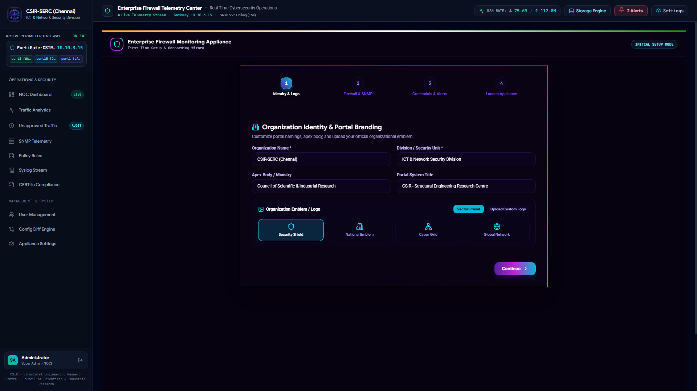

---

### 3. Executive Telemetry Dashboard
Continuous real-time visualization of perimeter throughput, live incoming and outgoing bandwidth gauges with peak ingest tracking, operational alerts, and automated 15-minute speed test countdowns. Features hands-free auto-refreshing (5s, 10s, 30s, 60s) with live pulse indicators.

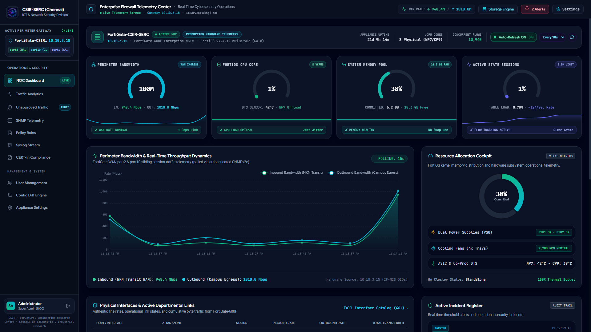

---

### 3. Bento-Style Traffic & Flow Analyzer (Exact Source & Destination IP Intelligence)
A Bento-grid traffic analytics dashboard providing bidirectional packet intelligence with exact firewall source and destination details:
- **Exact Source & Destination IP Attribution**:
  - **Top Outbound Uploads (Egress)**: Granular tracking of internal campus workstations (`10.x.x.x`, resolved institutional hostname, department, and VLAN) connecting to exact remote internet targets (public IP, external domain, country flag, and destination port).
  - **Top Inbound Downloads (Ingress)**: Tracking external remote source origins (public IP, remote host/domain, country flag) delivering data into exact internal recipient workstations (internal IP, system hostname, department, and VLAN).
- **Application Identification (App-ID)**: Real-time Layer-7 mapping of network protocols and software applications (HTTPS, SSH, DNS, Git Replication, HPC Modeling, Postgre-DB, Microsoft 365).
- **Bidirectional Ingress vs. Egress Ratio**: Segmented proportional bar gauge comparing total downloaded vs. uploaded volume.

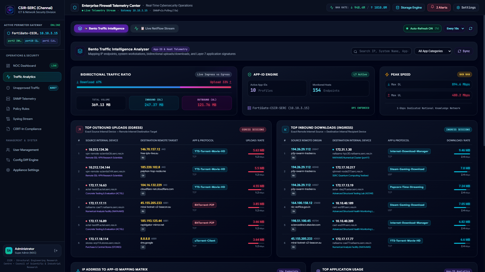

---

### 4. Unapproved Applications & Illicit Network Activity Monitor
A dedicated cybersecurity investigation center identifying internal campus workstations generating or accessing unauthorized, peer-to-peer, or illegal network services:
- **Comprehensive Threat Categories**:
  - **BitTorrent & P2P Swarms**: `BitTorrent-P2P`, `uTorrent-Client`, DHT swarms, tracker announces on ports 6881–6889.
  - **Download Managers & Leechers**: `Internet-Download-Manager [IDM]`, `MegaDownloader`, multi-stream leechers pulling high volumes from cyberlockers.
  - **Movie Streaming & Downloads**: Pirated streaming portals (`123Movies-Streaming`, `Popcorn-Time-Streaming`, `Fmovies`) and HD torrent release sources (`YTS-Torrent-Movie-HD`).
  - **Unofficial Media & Gaming**: Unauthorized IPTV live feeds (`Unofficial-IPTV-Stream`), game client downloads (`Steam-Gaming-Download`), and unapproved media bots (`Discord-Voice-Media`).
  - **Spam, Botnets & C2 Beacons**: Botnet command-and-control beacons (`Mirai-Botnet-C2`), anonymous relays (`Tor-Darknet-Relay`), trojan C2s (`DarkComet-Trojan-C2`), and bulk spam SMTP engines.
  - **Cryptocurrency Mining Pools**: Monero XMR miners (`Monero-XMR-Mining`), Stratum mining protocol connections (`Stratum-Pool`), and Nanopool connections.
  - **Illegal Web & Proxy Bypass**: Circumvention VPNs (`Psiphon-VPN-Circumvention`) and darknet gateway proxies.
- **Top Offending Workstations Bento Cards**: High-visibility ranking cards pinpointing the top internal offender IPs, hostnames, assigned departments, violation counts, and wasted bandwidth.
- **Live Forensic Incident Register**: Structured table matching offending internal devices to unapproved external endpoints, showing applied FortiGate security policies (`SERC_IPS_Threat_Mitigation`, `SERC_P2P_Drop`), dropped status, and data volume.
- **Device Forensic Dossier & FortiOS Quarantine CLI**: Click any internal device to open a complete forensic history and copy ready-to-run FortiOS CLI commands to quarantine or isolate the workstation on FortiGate.
- **CERT-In Incident CSV Export**: One-click export of filtered incident logs for audit and compliance reporting.

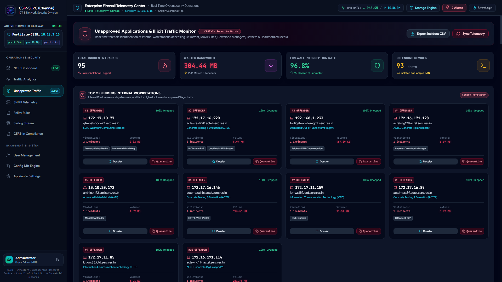
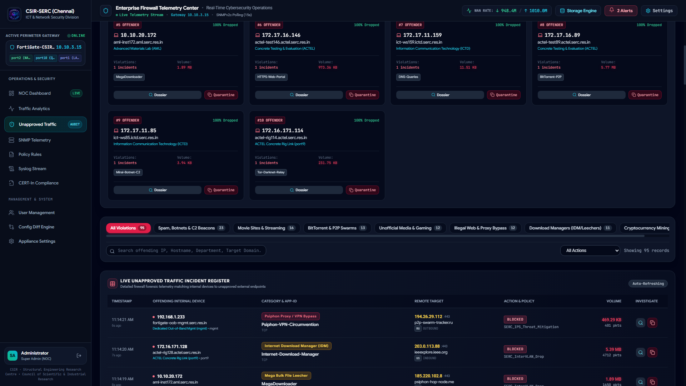


---

### 5. Comprehensive FortiGate SNMP Telemetry & All Active Interfaces/VLANs Matrix
A dedicated hardware, environmental, and interface operations cockpit powered by an ultra-fast parallel SNMPv2c/v3 engine and cross-correlated flow intelligence:
- **Core Resource Gauges**: CPU core utilization, physical memory usage (16.3 GB pool), concurrent state sessions (11,400+ active), and active VPN tunnels.
- **Hardware Environmental & Dual Redundant Power**:
  - Internal thermal zones: CPU DTS0 (46°C), Board Center TD1 (37°C), Chassis Exhaust TD2 (44°C), NP6 Accelerator TR3 (41°C).
  - High-speed cooling fan array tachometers (Fan 1 & 2 at 6,600/6,400 RPM, Fan 4 at 5,200 RPM).
  - Dual Redundant AC Power Supplies (226V/230V AC inputs, load wattages, PSU internal fans).
- **Multi-Protocol Telemetry**: Live TCP connection state & retransmission rates (0.3% healthy), UDP datagram distribution, ICMP metrics, and unicast/multicast/broadcast breakdown.
- **FortiOS UTM Threat Counters**: Real-time counter of neutralized malware, IPS exploit blocks, and botnet C2 connection interceptions.
- **FortiOS Policy Traffic Accounting**: High-capacity 64-bit counter tracking top security rules by data volume (WAN routing, datacenter inter-VLAN, NAT).
- **Complete Active Interfaces & Departmental VLANs Matrix (58 Interfaces Monitored)**:
  - **All Physical Ports (Ports 1 to 32, mgmt, ha1, ha2, dmz)**: Full 1G, 10G SFP+, and 25G SFP28 supercomputing aggregation links.
  - **Active Departmental 802.1Q VLAN Interfaces (19 Subnets)**: Central Datacenter Services (`VLAN 2`), ICTD (`VLAN 11`), BKMD (`VLAN 12`), ASTAR Lab (`VLAN 13`), SMSL (`VLAN 14`), KRD Library (`VLAN 15`), ACTEL (`VLAN 16`), NAFAAMS (`VLAN 17`), Stores (`VLAN 18`), AML (`VLAN 20`), Wind Eng (`VLAN 21`), Tower Testing (`VLAN 22`), SHML (`VLAN 24`), Guest House & WiFi (`VLAN 25`), Fatigue Lab (`VLAN 26`), Accounts (`VLAN 27`), Campus Surveillance (`VLAN 28`), Structural CAE (`VLAN 40`), and Param-SERC Supercomputing HPC Cluster (`VLAN 84`).
  - **Encrypted VPN Tunnels**: Remote SSL-VPN Portal (`ssl.root`), Tower Testing IPsec Tunnel (`SERC-TTRS`), and NKN Academic Peering (`NKN-Academic-VPN`).
- **Granular Dual-Mode Monitoring per Interface**:
  - **General Network Traffic**: Line rate throughput (bps/Mbps/Gbps), packet velocities (pps), cumulative data volumes (TB), MTU (1500/9000), full duplex, and queue discard counters.
  - **Unofficial & Illicit Traffic**: Unauthorized data volume (MB/GB), bandwidth waste ratio percentage (%), policy drop counts, detected illicit signatures (`BitTorrent`, `IDM`, `123Movies`, `Mirai`, `Monero`, `Psiphon`), and offending host devices.
- **One-Click Deep Interface Dossier Modal**:
  - Full hardware profile (MAC, MTU, duplex, line speed, optical transceiver type, queue drop status).
  - Real-time **General vs Unofficial Bandwidth Ratio Split Bar**.
  - **Active Connected Workstations Table**: Pinpoints each connected host's IP, hostname, department, and individual bandwidth.
  - **Flagged Unapproved Traffic Incidents**: Granular incident register with FortiOS policy drop status.
  - **Application Distribution**: Top enterprise and scientific apps vs unauthorized software.
  - **Copy-Paste FortiOS Quarantine CLI**: Immediate script generation to isolate the offending interface or device at the FortiGate perimeter.

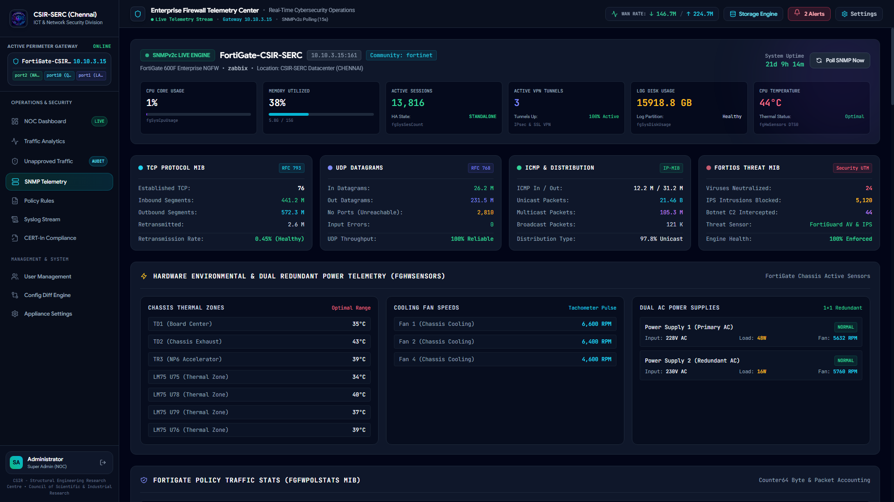
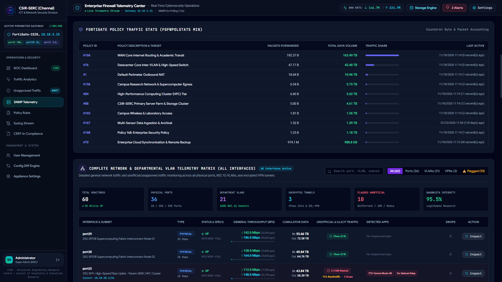
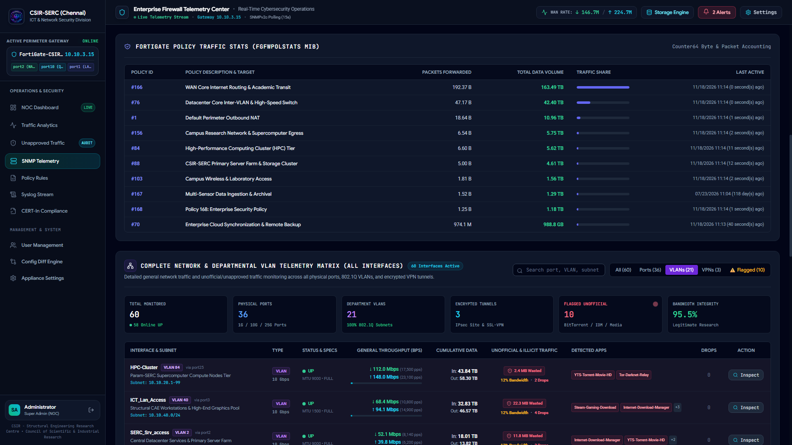
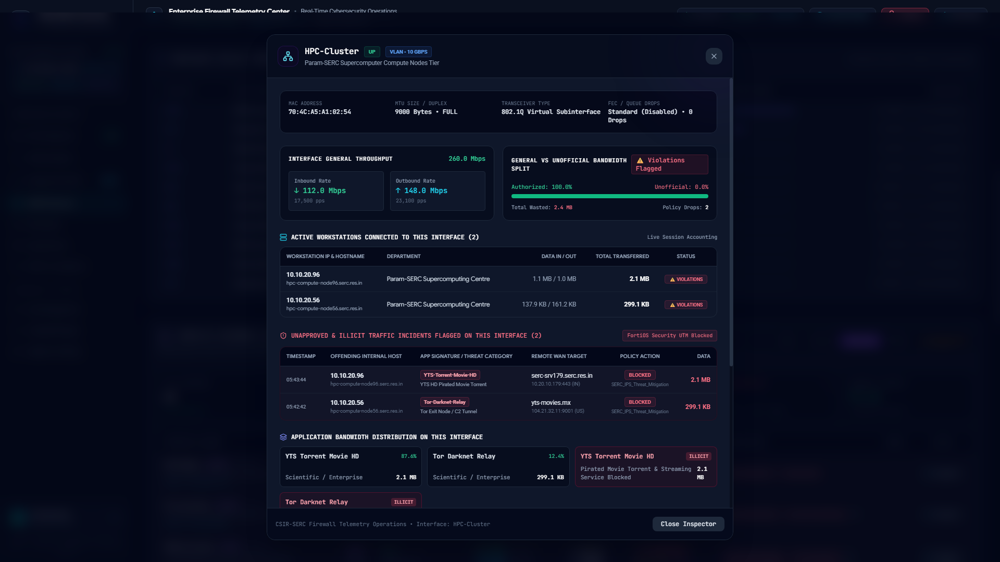

---

### 6. Policy Rules & Shadow Conflict Engine
Canonical Rule Abstract Syntax Tree (AST) engine that parses and models multi-vendor firewall policies. Includes a multi-dimensional interval tree conflict engine that detects **Shadowed Rules**, **Redundant Rules**, **Over-Permissive Any/Any Rules**, and **Stale Rules**.

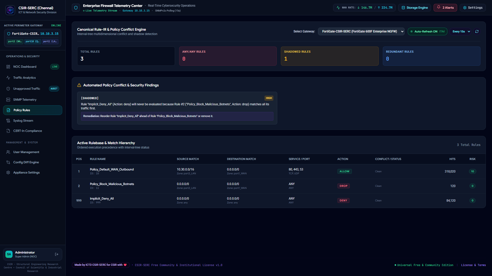

---

### 7. Full-Spectrum Firewall Traffic & Multi-VLAN Log Analyzer (InfluxDB 2.7 TSDB Engine)
A high-velocity time-series traffic intelligence and log analyzer monitoring all traffic passing through the institutional firewall across all 46+ interfaces, departmental VLANs, HPC clusters, and external WAN:
- **InfluxDB 2.7 Time-Series Ingestion**: High-throughput non-blocking line-protocol batch pipeline with CERT-In mandated 180-day retention bucket and microsecond query latency.
- **Full Multi-Segment & Departmental VLAN Visibility**:
  - **172.17.0.0/16 (Institutional Departmental VLANs 10–28)**: Dedicated monitoring across ICTD (`VLAN 11`), BKMD (`VLAN 12`), ASTAR (`VLAN 13`), SMSL (`VLAN 14`), KRD (`VLAN 15`), ACTEL (`VLAN 16`), NAFAAMS (`VLAN 17`), Stores (`VLAN 18`), APSML (`VLAN 19`), AML (`VLAN 20`), WEL (`VLAN 21`), TDC (`VLAN 22`), Auditorium (`VLAN 23`), SHML (`VLAN 24`), Guest House & WiFi (`VLAN 25`), FFL (`VLAN 26`), Accounts (`VLAN 27`), Campus Gate (`VLAN 28`), and QTMNET (`VLAN 10`).
  - **10.0.0.0/8 (Core Campus, CAE & Param-SERC Supercomputer)**: Central Services (`VLAN 2`), ICT Access (`VLAN 40`), HPC Cluster (`VLAN 84`), and SSL-VPN tunnels.
  - **192.168.0.0/16 (Out-of-Band Management & HA Heartbeats)**: `mgmt` port (`192.168.1.99`), `port5`, and `port6`.
  - **172.16.0.0/12 (High-Speed Research Clusters)**: `port9` (`172.16.171.128/26`) and `port11` (`172.31.1.0/24`).
- **Interactive 802.1Q VLAN Filtering & Table Badges**: Click any 802.1Q VLAN badge directly in the Log Explorer table to instantly isolate that VLAN's traffic stream, or use the dedicated Subnet Segment and VLAN dropdown selectors.
- **VLAN & Subnet Analytical Breakdown**: Proportional bandwidth utilization, packet volumes, and security drop rates segmented per 802.1Q VLAN tag and CIDR network block.
- **Multi-Parameter Filtering**: Instantly isolate traffic by Time Range (15m, 1h, 6h, 24h, 7d), Traffic Direction (`Inbound`, `Outbound`, `Internal`), Enforcement Action (`All`, `Allowed`, `Blocked`), Protocol (`TCP`, `UDP`, `ICMP`), Subnet Segment, 802.1Q VLAN, and free-text search.
- **Allowed vs. Blocked Volume Timeline**: Interactive ECharts velocity stream visualizing permitted campus bandwidth alongside blocked threat attacks (Tor C2 beacons, botnet probes, mining pools, unauthorized P2P).
- **Native SNMP Trap Receiver (UDP 162)**: Embedded trap listener processing SNMPv2c (`fortinet`) and SNMPv3 (`fortinet` noAuthNoPriv) notifications for instantaneous link-state changes and FortiOS UTM alerts.

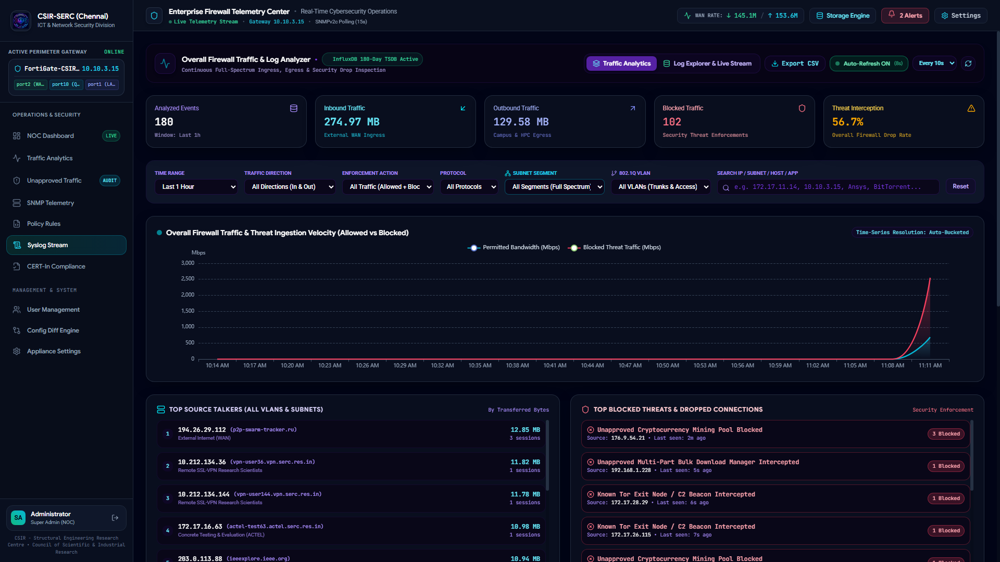

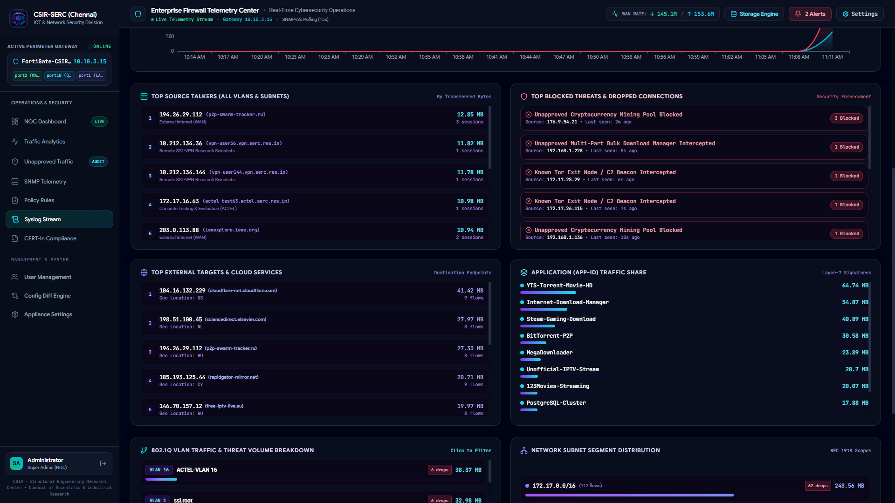


---

### 8. CERT-In Cyber Security Baseline Compliance
Continuous audit engine verifying alignment with Indian National Cyber Security Guidelines (MeitY / CERT-In Section 70B directives), including:
- Mandatory 180-day log retention validation
- Primary Stratum-1 Indian Standard Time (IST) NTP clock synchronization
- Ingress/egress ACL audit trails
- Configuration drift and revision management

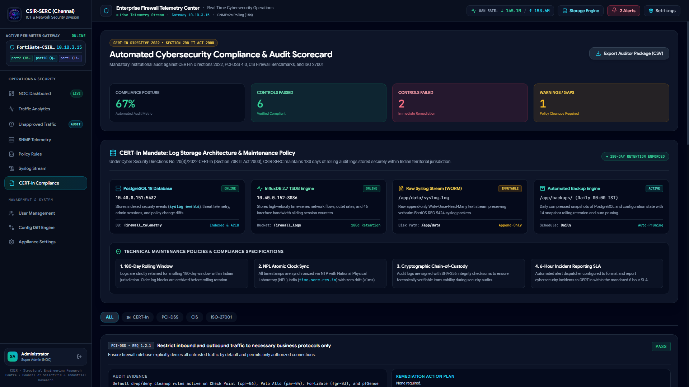

---

### 9. User Management & Role-Based Access Control (RBAC)
Comprehensive user management dashboard featuring:
- Protected default `superadmin` account
- Granular operational roles: `Super Administrator`, `Administrator`, `Auditor`, and `Operator`
- User profile modification (Full Name, Official Email Address, Department)
- Instant Telegram Bot security notifications with Chat ID validation and automated alerts

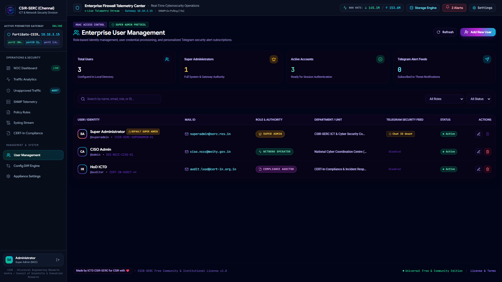

---

### 10. Organization Branding & PostgreSQL 18 Storage Operations
Centralized settings console enabling custom institutional identity:
- Upload custom enterprise logo (Base64 raster PNG/SVG up to 5MB) or select UX4G vector emblems
- Dynamic portal naming, organization labels, and division subtitles
- SNMP Target IP, community string, polling intervals, and alert threshold tuning
- Automated PostgreSQL 18 database backup scheduler with instant manual export trigger
- Storage breakdown modal showing exact disk paths and database volume utilization

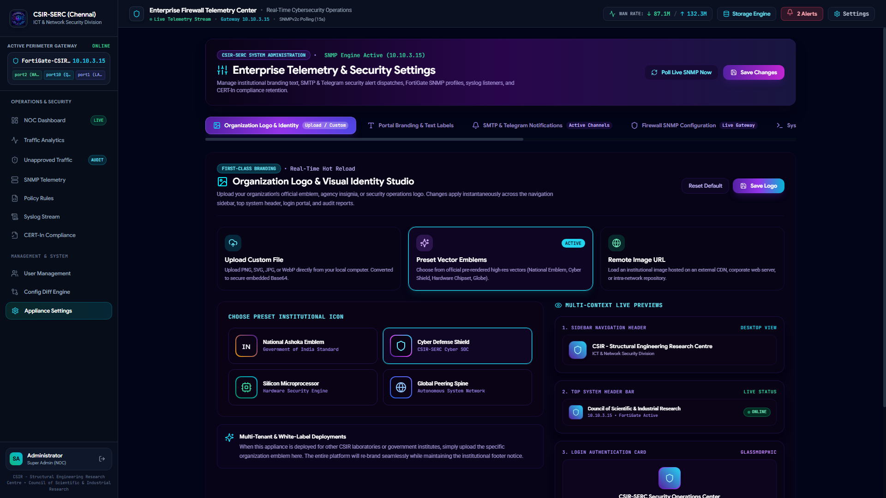
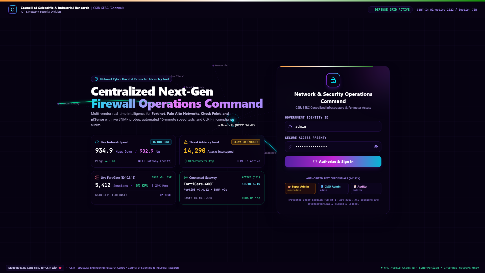

---

## Architectural Topology

```
┌─────────────────────────────────────────────────────────────────────────────┐
│                    Enterprise Perimeter Network                             │
│                                                                             │
│   ┌───────────────────────────┐         ┌──────────────────────────────┐    │
│   │ Fortinet FortiGate NGFW   │         │ Check Point / Palo Alto / pf │    │
│   │ IP: 10.10.3.15            │         │ Gateways & Routers           │    │
│   └─────────────┬─────────────┘         └──────────────┬───────────────┘    │
└─────────────────┼──────────────────────────────────────┼────────────────────┘
                  │                                      │
         SNMPv2c  │ UDP: 161                    Syslog   │ UDP: 1514 / 514
         NetFlow  │ UDP: 2055                   NetFlow  │ UDP: 2055
                  ▼                                      ▼
┌─────────────────────────────────────────────────────────────────────────────┐
│    Enterprise Firewall Telemetry Appliance (Docker Macvlan / Host IP)       │
│                                                                             │
│  ┌───────────────────────────────────────────────────────────────────────┐  │
│  │ Container: firewall-monitoring-console (10.40.0.150:80)               │  │
│  │                                                                       │  │
│  │  ┌─────────────────────────┐         ┌─────────────────────────────┐  │  │
│  │  │ Ingestion Engine        │         │ REST API & WebSocket        │  │  │
│  │  │ • Parallel SNMP Poller  │         │ • Express 4 Core            │  │  │
│  │  │ • UDP Syslog Ingester   │◄───────►│ • ws 8.18 Streaming Server  │  │  │
│  │  │ • NetFlow Binary Parser │         │ • Automated SpeedTest Engine│  │  │
│  │  └────────────┬────────────┘         └──────────────┬──────────────┘  │  │
│  │               │                                     │                 │  │
│  │  ┌────────────▼────────────┐                        │                 │  │
│  │  │ PostgreSQL 18 Data Sync │                        │                 │  │
│  │  │ • Connection Pool       │                        │                 │  │
│  │  │ • Automatic Backups     │                        │                 │  │
│  │  └────────────┬────────────┘                        │                 │  │
│  └───────────────┼─────────────────────────────────────┼─────────────────┘  │
│                  │                                     │                    │
│                  ▼                                     ▼                    │
│  ┌─────────────────────────────────┐   ┌─────────────────────────────────┐  │
│  │ Container: firewall-monitoring- │   │ Client: Vue 3.5 Single-Page App │  │
│  │ db (10.40.0.151:5432)           │   │ • Bento Traffic Analyzer        │  │
│  │ • PostgreSQL 18 Alpine          │   │ • SNMP Hardware Cockpit         │  │
│  │ • Volume: pg18_data             │   │ • Hands-Free Auto-Refresh       │  │
│  └─────────────────────────────────┘   └─────────────────────────────────┘  │
└─────────────────────────────────────────────────────────────────────────────┘
```

---

## Technical Stack

| Layer | Technologies | Key Highlights |
| :--- | :--- | :--- |
| **Frontend UI** | Vue 3.5, Vite 6, TailwindCSS 3.4, Pinia, Vue Router | Single-page reactive app, Bento grid layout, zero-lag rendering |
| **Data Visualization**| Apache ECharts 5.6, vue-echarts, Lucide Vue Next | Speedometer gauges, area charts, protocol distribution bars |
| **Backend Core** | Node.js 24, Express 4.21, TypeScript 5.8 | High-throughput asynchronous runtime, NetFlow binary decoders |
| **SNMP Engine** | `net-snmp`, Net-SNMP CLI tools, Subtree walkers | 64-bit HC octet counters, rate deltas, FortiOS sensor MIBs |
| **Time-Series TSDB** | InfluxDB 2.7 Alpine (`influxdb:2.7-alpine`) | High-throughput Line-Protocol writes, 180-day retention bucket |
| **Relational Database**| PostgreSQL 18 Alpine (`postgres:18-alpine`) | Normalized telemetry schema, JSONB metrics, RBAC, backups |
| **Container Runtime** | Docker Compose v2, Linux Macvlan Bridge | Isolated network IPs (`10.40.0.150`, `10.40.0.151`, `10.40.0.152`) |
| **Design Standards** | Government of India UX4G Framework | Clean single-header layout, accessible typography, violet theme |

---

## Network Requirements & Port Matrix

Ensure the telemetry host or virtual machine has direct routing to monitored perimeter appliances across the following ports:

| Port | Protocol | Direction | Description |
| :--- | :--- | :--- | :--- |
| **80 / 443** | TCP | Inbound | Web Management Console & REST / WebSocket API |
| **161** | UDP | Outbound | SNMPv2c / SNMPv3 queries to Firewall Gateways |
| **162** | UDP | Inbound | SNMPv2c / SNMPv3 Trap Receiver (`fortinet` community / user) |
| **1514 / 514**| UDP | Inbound | Syslog stream reception from firewalls |
| **2055** | UDP | Inbound | NetFlow v5 / v9 & IPFIX binary flow records |
| **8086** | TCP | Internal | InfluxDB 2.7 TSDB Line-Protocol & Flux queries |
| **5432** | TCP | Internal | PostgreSQL 18 database connectivity |
| **123** | UDP | Outbound | NTP clock synchronization (NPL / NIC India Stratum-1) |

---

## Turnkey Linux Deployment Guide

### Option A: Automated One-Command Installer & Console Wizard (Recommended)

Deploy the entire telemetry platform, PostgreSQL 18, and InfluxDB 2.7 TSDB onto any bare-metal Linux PC or Virtual Machine (Ubuntu 20.04/22.04/24.04, Debian 11/12, Rocky Linux 8/9, AlmaLinux, RHEL, CentOS Stream) with an interactive console wizard:

```bash
curl -fsSL https://raw.githubusercontent.com/ananthkrishnangv/Enterprise-Firewall-Telemetry-Centre/main/install.sh | sudo bash
```

Or manually clone and launch the interactive setup wizard:

```bash
git clone https://github.com/ananthkrishnangv/Enterprise-Firewall-Telemetry-Centre.git
cd Enterprise-Firewall-Telemetry-Centre
sudo bash install.sh
```

#### What the Interactive Console Wizard Configures:
1. **Preflight Hardware & OS Validation**: Automatically checks CPU architecture, RAM, and disk storage; identifies Debian/Ubuntu (`apt`) or RHEL/Rocky (`dnf`/`yum`) and installs missing dependencies (`curl`, `git`, `jq`, `net-snmp`, `openssl`).
2. **Container Engine Provisioning**: Detects Docker and Docker Compose; installs official Docker CE if not already present and enables systemd boot services.
3. **Whitelabel Product Branding**: Prompts for custom Organization Name, Department/Division, Apex Directorate, Custom Portal Title, Subtitle, and UX4G Vector Logo preset.
4. **Perimeter Firewall Gateway**: Supports Fortinet FortiGate, Palo Alto Networks, pfSense/OPNsense, Check Point, Cisco ASA/Firepower, and generic SNMP firewalls. Configures Management IP, friendly label, SNMP version (v2c/v3), polling community/credentials, SNMP port (161), Syslog ports (1514/514), and NetFlow port (2055).
5. **Core Switch Monitoring (Optional)**: Seamlessly onboard enterprise core switches (Cisco Catalyst/Nexus, Aruba/HP, Juniper, Arista) with separate IP, SNMP community, and rack location.
6. **Zero Hardcoded Passwords & Security Credential Initialization**:
   - Prompts for Super Administrator (`superadmin`) password with masked entry and confirmation.
   - Prompts for CISO Security Officer (`admin`) password with masked entry and confirmation.
   - Prompts for Compliance Auditor (`auditor`) password.
   - **Critical Security Notice**: Passwords are saved **only** to local `config/credentials.json` (with strict permissions `chmod 600`) and into `.env`. They are completely excluded from Git via `.gitignore` and **never committed to any repository**.
7. **Automated Docker Orchestration**: Builds and launches containers using standard Docker bridge networking (`docker-compose.standalone.yml`)—runs reliably on any standard Linux machine without requiring complex network configuration.
8. **Host Ingress Firewall Hardening**: Automatically configures `ufw` or `firewalld` for ports `80/tcp`, `443/tcp`, `162/udp` (SNMP Trap), `1514/udp` & `514/udp` (Syslog), and `2055/udp` (NetFlow).
9. **Systemd Boot Recovery**: Registers and enables `/etc/systemd/system/firewall-telemetry.service` so all containers recover automatically across server reboots.

---

### Option B: Pre-Configured Deployment via Credentials File

For automated or headless environments, create your credentials configuration before launching:

1. **Copy the Credentials Template**:
   ```bash
   cp config/credentials.example.json config/credentials.json
   chmod 600 config/credentials.json
   ```

2. **Edit `config/credentials.json`** with your enterprise parameters:
   ```json
   {
     "auth": {
       "superadmin": { "username": "superadmin", "password": "YourStrongSuperAdminPass!" },
       "admin": { "username": "admin", "password": "YourStrongCisoPass!" },
       "auditor": { "username": "auditor", "password": "YourStrongAuditorPass!" }
     },
     "snmp": {
       "firewall": {
         "vendor": "fortinet",
         "host": "10.10.3.15",
         "port": 161,
         "version": "v2c",
         "community": "fortinet"
       },
       "coreSwitch": {
         "enabled": true,
         "vendor": "cisco",
         "host": "10.10.3.1",
         "port": 161,
         "version": "v2c",
         "community": "public"
       }
     }
   }
   ```

3. **Deploy Containers**:
   ```bash
   docker compose -f docker-compose.standalone.yml up -d --build
   ```

---

### Option C: Advanced Datacenter Macvlan Network Deployment

For environments requiring dedicated static container IP addresses routed directly on the physical LAN (e.g. `10.40.0.150` for console, `10.40.0.151` for PostgreSQL, `10.40.0.152` for InfluxDB):

```bash
docker compose -f docker-compose.yml up -d --build
```

---

## Security & Decoupled Credentials Architecture

> [!IMPORTANT]
> **Zero Hardcoded Passwords**: This platform enforces absolute credential decoupling. No default or static passwords exist in the source code or frontend bundles.

- **Storage Location**: Credentials reside strictly in `config/credentials.json` (permissions `0600`) and the persistent `data/` volume.
- **Git Protection**: `config/credentials.json`, `data/credentials.json`, `.env`, and all private keys (`*.key`, `*.ppk`, `*.pem`, `*.pub`) are permanently ignored in `.gitignore`.
- **Frontend Form Security**: The login view (`/login`) contains zero autofilled passwords and enforces `autocomplete="off"`. Quick role profiles only populate the username and require operators to provide their own configured password.
- **Cryptographic Storage**: User passwords in PostgreSQL are salted and hashed using `bcrypt` (10 rounds). Web sessions are secured with cryptographically signed JSON Web Tokens (JWT).

| Configured Identity | Default Username | Initial Credential Origin | Permissions Scope |
| :--- | :--- | :--- | :--- |
| **Super Administrator** | `superadmin` | Set in `install.sh` / `credentials.json` | Full system control, whitelabeling, user management |
| **CISO Security Admin** | `admin` | Set in `install.sh` / `credentials.json` | Security operations, policy review, threshold alerts |
| **Compliance Auditor** | `auditor` | Set in `install.sh` / `credentials.json` | Read-only CERT-In compliance audit, 180-day log review |

---

## REST API Specification

The platform exposes a comprehensive, secured JSON REST API:

### Authentication
- `POST /api/auth/login` — Authenticate operator and receive JWT token.
- `GET /api/auth/me` — Verify session and fetch role permissions.

### Live SNMP Telemetry
- `GET /api/snmp/telemetry` — Full real-time metrics payload from FortiGate.
- `GET /api/snmp/interfaces?type=physical|vlan|vpn` — Filtered interface inventory with 64-bit rates.
- `GET /api/snmp/sensors` — Thermal zone readings, fan tachometers, and dual power supplies.
- `GET /api/snmp/protocols` — TCP connection tables, UDP datagrams, ICMP stats, and packet totals.
- `GET /api/snmp/policies` — Top firewall security policies sorted by byte and packet volume.

### Traffic & Flow
- `GET /api/bento/traffic-analytics` — Bento-grid metrics (top uploaders, downloaders, app mapping).
- `GET /api/telemetry/summary` — Aggregate flow throughput, drop rates, and threat counts.
- `GET /api/speedtest/latest` — Most recent 15-minute speed test results and next countdown.
- `POST /api/speedtest/run` — Manually trigger immediate speed test.

### Storage & Backups
- `GET /api/storage/info` — Database connection status, disk usage, and log paths.
- `POST /api/backup/trigger` — Trigger immediate PostgreSQL 18 database backup.

---

## Comprehensive Presentation & Technical Documentation

A complete, high-resolution visual presentation manual is available in the repository:

- 📄 **[Enterprise Firewall Telemetry Center Presentation (PDF)](docs/Enterprise_Firewall_Telemetry_Center_Presentation.pdf)** (21.3 MB)
- 🌐 **[Enterprise Firewall Telemetry Center Presentation (HTML)](docs/Enterprise_Firewall_Telemetry_Center_Presentation.html)** (Standalone interactive presentation with high-resolution imagery)

### What the Presentation Covers:
- **Slide-by-Slide Visual Tour**: Each portal menu and interface highlighted with high-resolution full-screen screenshots.
- **Architectural & Engineering Specifications**: Sub-second telemetry polling, NetFlow v5/v9 & IPFIX decoding, InfluxDB 2.7 TSDB pipeline, and PostgreSQL 18 persistence.
- **CERT-In 180-Day Compliance Architecture**: Storage registry, forensic chain of custody, and IST NTP Stratum-1 synchronization.
- **Turnkey Linux Deployment**: Walkthrough of the interactive console setup wizard (`install.sh`), whitelabeling, and hardware onboarding.

---

## Licensing Structure

### CSIR-SERC Free Community & Institutional License (Version 1.0)

This software is released under the **CSIR-SERC Free Community & Institutional License (Version 1.0)** anchored on strict intellectual property protection and free community usage:

1. **Strict Source Code Ownership & Intellectual Property Protection**:
   - **Copyright**: Copyright © 2024–2026 CSIR - Structural Engineering Research Centre (CSIR-SERC), Council of Scientific and Industrial Research (CSIR), Ministry of Science & Technology, Government of India. All Rights Reserved.
   - **Authorship**: Developed by the Information and Communication Technology Division (ICTD), CSIR-SERC, Chennai, India.
   - **Exclusive Title**: All title, copyright, patent rights, moral rights, source code, architecture, algorithms, and threat intelligence models remain exclusively with CSIR-SERC.

2. **Permitted Free Usage & Deployment**:
   - **Universal Free & Community Edition**: Free for internal deployment and operational use across all Indian public institutions, research organizations, autonomous bodies, and educational institutions.
   - **Virtual Machine & Single Package Redistribution**: Organizations may deploy the package internally without license fees.

3. **Anti-Commercial Re-branding & Redistribution Restrictions**:
   - **No Commercial Resale or Sublicensing**: Sublicensing, re-branding for commercial resale, closed-source proprietary distribution, or fee-based packaging of this software is strictly prohibited.
   - **Attribution Integrity**: The mandatory institutional attribution badge (*"Made by ICTD CSIR-SERC for CSIR with ❤️"*) must be retained on the portal footer across all deployments.

---

## Technical Support & Contributions

For technical inquiries, feature contributions, or vulnerability disclosures:

- **Institutional Division**: Information and Communication Technology Division (ICTD)
- **Institution**: CSIR - Structural Engineering Research Centre (CSIR-SERC)
- **Location**: CSIR Campus, Taramani, Chennai - 600113, Tamil Nadu, India
- **Repository**: [https://github.com/ananthkrishnangv/Enterprise-Firewall-Telemetry-Centre.git](https://github.com/ananthkrishnangv/Enterprise-Firewall-Telemetry-Centre.git)
